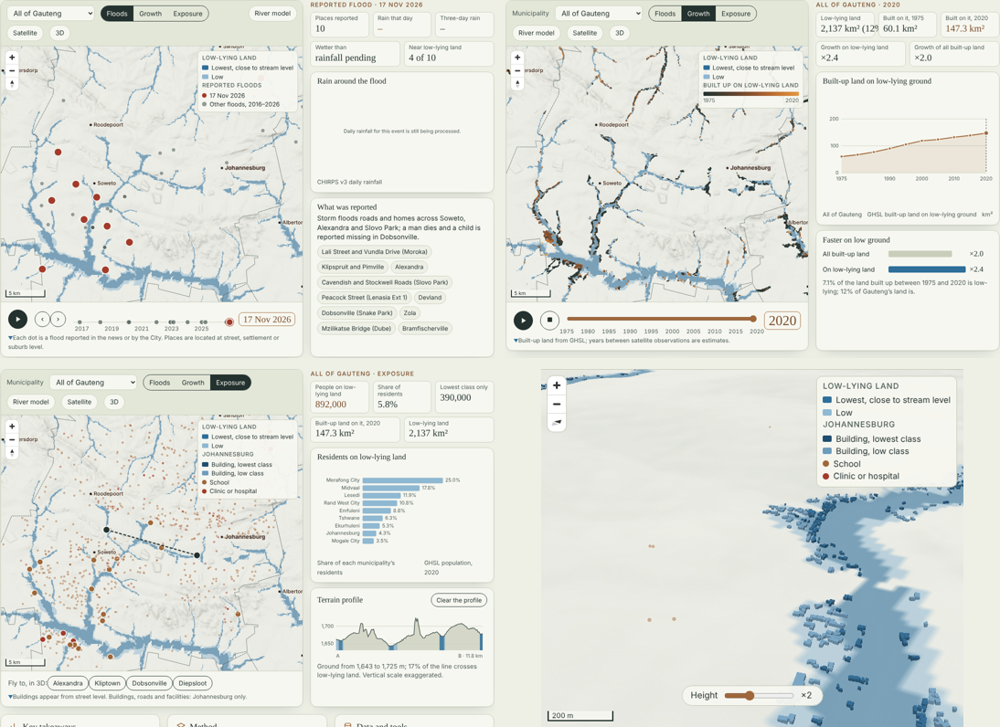

# flood-line-za

**Where Gauteng floods, and who lives there.** This project maps low-lying land along Gauteng's streams from a bare-earth terrain model, and checks it against floods reported since 2016. It then asks two more questions:
- How much building has spread onto low ground since 1975?
- Which people, homes, roads, schools and clinics sit on it today?

**Explore it:** [seabilwe.github.io/map-flood-line-za.html](https://seabilwe.github.io/map-flood-line-za.html) (an interactive 3D dashboard: floods, growth and exposure)



## Findings

| | Gauteng | Johannesburg |
|---|---|---|
| Low-lying land (both classes) | 2,137 km² (12%) | 147 km² (9%) |
| Built-up land on it, 1975 → 2020 | 60 → 147 km² (×2.4) | 10 → 28 km² |
| All built-up land, 1975 → 2020 | ×2.0 | |
| Residents on it (GHS-POP 2020) | about 892,000 (5.8%) | about 250,000 (4.3%) |
| Wards where more than a fifth of residents live on it (2020 wards) | 62 of 529 | |
| Buildings on it | | 68,092 (30,198 in the lowest class) |
| Roads on it | | 884 km |
| Schools / clinics and hospitals on it (OpenStreetMap) | | 27 / 9 |

- **Low ground was long avoided.** In 1975 only 5% of Gauteng's built-up land was low-lying, against 12% of all land. 7.1% of the land built up since then is, so building on low ground has grown faster than building overall.
- **Buildings on the lowest ground are smaller.** In Johannesburg the median footprint there is 36 m², against 45 m² across the city.
- **Reported floods fall near the map's lowest class.** 70% of the better-located reports lie within 500 m of it, against 35% of built-up Johannesburg. Reports also cluster along the larger streams (the Jukskei and the Klipspruit): 57% of the better-located reports are within 1 km of a stream draining 50 km² or more, against 16% of built-up Johannesburg.
- **The global river model misses most of it.** Only 6 of the 54 reported places are within 500 m of the JRC 1-in-100-year flood zone, and some of those are next to dams.

## How it works

```
scripts/acquire_data.py   FABDEM tiles (range reads out of the 10-degree zip), JRC river flood hazard, CHIRPS v3 daily rain,
                          OpenStreetMap, GHSL building height, Overture buildings (DuckDB, anonymous S3)
scripts/hazard.py         30 m DEM in UTM 35S; GRASS r.watershed; height above the nearest stream (pointer jumping in NumPy);
                          the two low-lying classes; municipalities; JRC on the same grid; the ponding-hollow test
scripts/analysis.py       growth onto low ground (GHSL, from urban-edge-za), people, roads, schools, clinics and buildings on it,
                          and the check against reported floods
scripts/web_rain.py       rain behind each reported flood, Johannesburg average, ranked against wet-season days since 1998
scripts/web_tiles.py      PMTiles: terrarium terrain from FABDEM, and styled raster tiles for the low-lying classes and JRC
scripts/web_vectors.py    PMTiles: vector tiles of growth on low ground and of exposed buildings with estimated heights
scripts/web_data.py       the small JSON and GeoJSON files the page reads, including residents on low-lying land per 2020 ward
data/incidents_raw.csv    54 reported flood places, 2016-2026, with sources; incidents.geojson is the geocoded version
```

Run `acquire_data.py`, `hazard.py` and `analysis.py` in the QGIS Python console, in that order (QGIS 3.44 with the GRASS provider; DuckDB through `pip install --user duckdb`). The `web_*.py` scripts run in any Python with rasterio, shapely, mercantile, mapbox-vector-tile and pmtiles. `analysis.py` reads the first-built year and population from the companion project [urban-edge-za](https://github.com/seabilwe/urban-edge-za).

**The classes.** Streams are cells that at least 1 km² drains through; classes are drawn only along streams draining at least 5 km². Each cell's height above the stream it drains to (HAND) is compared with a depth that grows with the stream's catchment, *h* = A<sup>0.3</sup> m with A in km². This follows hydraulic geometry: depth ∝ Q<sup>0.4</sup> and Q ∝ A<sup>0.75</sup>. *h* is 1.6 m at 5 km² and 4 m at 100 km². The lowest class is HAND ≤ *h*; the low class is HAND ≤ 2*h*. The 5 km² minimum was chosen by testing 1, 5, 10 and 25 km²: with every small gully included (1 km²) reported floods sat no closer to the classes than built-up land in general, and 5 km² was the smallest network that separated them clearly.

**The web page.** It uses plain JavaScript with MapLibre GL and PMTiles, so it needs no server. The 3D view uses the same terrain tiles as the terrain profile, so both show the same ground.

## Limits

- **Screening, not flood lines.** The classes mark ground that floodwater reaches first, not how often a place floods. Stormwater pipes, canals, culverts and recent works are not modelled.
- **Street flooding is invisible at 30 m.** Hollows where water ponds were tested and dropped: none lies within 500 m of a reported place.
- **Flat plains.** On the plains of Merafong, Midvaal and the Vaal, a few metres above the stream covers wide ground, so their low-lying shares are high.
- **Reports are uneven.** Floods in places the media covers are more likely to be reported. Many places are geocoded to a suburb centre, not the flooded street.
- **Buildings.** Footprints come from Overture Maps (mostly Google and Microsoft footprints, plus OpenStreetMap). The 3D heights are GHSL's average building height per hectare. Facility counts depend on how complete OpenStreetMap is.
- **Exposure, not vulnerability.** The ward map counts who lives on low-lying land. It does not yet weigh how well people can cope; Census 2022 ward tables (housing, services, age) would add that.
- **Rain.** CHIRPS blends satellite and gauge rain at about 5 km; a thunderstorm cell can be smaller. November 2026 values are preliminary.

## Data

- FABDEM v1-2 (Hawker et al. 2022), University of Bristol, CC BY-NC-SA 4.0.
- GloFAS global river flood hazard maps v2.1, European Commission, Joint Research Centre.
- CHIRPS v3 daily, Climate Hazards Center, UC Santa Barbara.
- GHS-BUILT-S, GHS-POP and GHS-BUILT-H R2023A, European Commission, Joint Research Centre.
- Overture Maps Foundation buildings, release 2026-11-18. © OpenStreetMap contributors.
- Flood reports from SAnews, the City of Johannesburg, TimesLIVE, SowetanLIVE, News24, Daily Maverick, EWN, The Citizen, SABC, GroundUp, Al Jazeera and IFRC; every place links to its source in `data/incidents_raw.csv`.
- Municipal Demarcation Board ward boundaries (2020) and municipal boundaries (via geoBoundaries).

Apart from the flood reports, the data isn't in this repository; the scripts download it.

## Licence

The code is MIT-licensed (see `LICENSE`). Derived terrain products inherit FABDEM's non-commercial licence.
